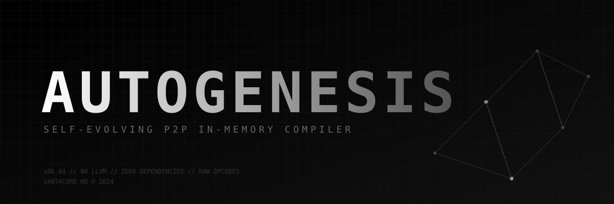

<div align="center">
  
  
  # AUTOGENESIS
  
  **Autonomous. Self-Evolving. In-Memory P2P JIT Compiler.**
  
  [](#)
  [](#)
  [](#)
  
  *“We don't write code. We write code that writes itself.”*
</div>

---

## What is this?

**AUTOGENESIS** is a decentralized P2P network where nodes generate raw machine code opcodes (x86_64), inject them directly into RAM via `mmap` / `VirtualAlloc` (`PROT_EXEC | PROT_WRITE`), and execute them.

No LLVM. No external crates. No compiler toolchains. 

The network mutates its own binary code in memory, benchmarks execution speed, and broadcasts the fastest mutations to peers over UDP. It is a genetic algorithm operating directly on hardware instructions.

## Core Mechanics

*   **In-Memory Execution:** Code exists only in RAM. Zero disk I/O.
*   **Self-Mutation:** A custom opcode generator injects raw instructions (`add rax, imm8`) on the fly.
*   **P2P Swarm:** Fastest genomes are synced via `UdpSocket`.
*   **Zero Dependencies:** Pure `std`, FFI, and unsafe memory manipulation.

## Quick Start (Single File Build)

No `cargo` required. Just `rustc`.

```bash
# Compile the monolith
rustc main.rs -O -o autogenesis

# Run Node 1 (Listens on 8080, sends to 8081)
./autogenesis 8080

# Run Node 2 in a separate terminal
./autogenesis 8081
